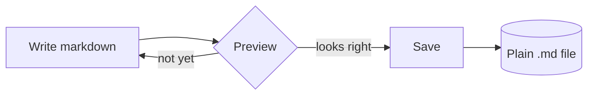

# Typing

A small, local-first markdown editor. **What you type is what you see**, and the
file on disk stays exactly the file you opened.

## Writing

Typing renders headings, *emphasis*, ~~strikethrough~~, `inline code`,
[links](https://example.com) and images as you go. Put the caret on a line and the
markdown markers appear so you can edit them; move away and they fade again.

- A bullet list
- With a nested list
  - like this
  - and this
- Back to the top level

1. Ordered lists work
2. And continue automatically
3. When you press return

- [x] Task lists show real checkboxes
- [ ] Click one to toggle it
- [ ] They round-trip as `- [ ]` in source mode

> Quotes are set apart, and stay readable in source mode.
>
> They can span several lines.

## Tables

| Feature      | State | Notes                     |
| ------------ | :---: | ------------------------- |
| Live preview |  yes  | Markers hide when idle    |
| Source mode  |  yes  | ⌘/ toggles                |
| Maths        |  yes  | KaTeX, inline and display |
| Diagrams     |  yes  | Mermaid fences            |

Add a row with ⌘↩, a column with ⇧⌘↩, or use the Table menu.

## Maths

Inline maths like $e^{i\pi} + 1 = 0$ renders in place, and display maths gets its
own centred block:

$$
\int_{-\infty}^{\infty} e^{-x^2}\,dx = \sqrt{\pi}
$$

## Diagrams



## Code

```ts
export function greet(name: string): string {
  return `hello, ${name}`
}
```

```python
def fib(n: int) -> int:
    return n if n < 2 else fib(n - 1) + fib(n - 2)
```

## Chinese and Japanese

中文写作应当同样顺手：标点自动配对不会打断输入，换行与段落保持原样。日本語の文章も同じように扱えます。

## The fidelity promise

Open a file, change nothing, save: the bytes are identical. Front matter, HTML
blocks, footnotes and syntax this editor does not understand are kept verbatim and
remain editable in source mode.

<details>
<summary>An HTML block, preserved as text</summary>
This content is never executed and is written back exactly as it was.
</details>

---

That is the whole idea: a calm place to write, and files you can trust.